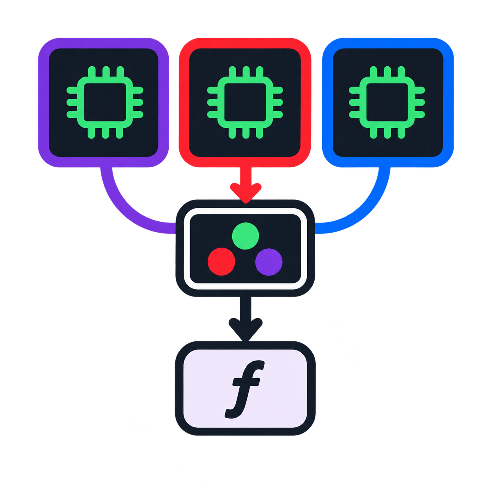

<p align="left">
  <a href="https://github.com/Janssena/KernelDispatch.jl/actions/workflows/test.yml"></a>
  <a href="https://janssena.github.io/KernelDispatch.jl/stable/"></a>
  <a href="https://janssena.github.io/KernelDispatch.jl/dev/"></a>
  <a href="https://julialang.org"></a>
</p>

# KernelDispatch.jl

<p align="center">
  
</p>


Simplify working with compiled kernel binaries built anywhere, directly in Julia!
- Define an op
- Register kernels for it
- Select default kernel and run the op on CPU and device arrays simply through multiple dispatch!
- Kernels can even run embedded in a Reactant-compiled program as a `stablehlo.custom_call`!

An operation can have several **kernels** (implementations) you switch between at runtime, each with
**tuned variants** picked from the inputs. Pure-Julia [KernelAbstractions](https://github.com/JuliaGPU/KernelAbstractions.jl) 
kernels are also supported as one more source of binaries: `ka_compile` turns one into a binary, and 
from there it is launched like any other. 

**Documentation** (tutorials and API reference): <https://janssena.github.io/KernelDispatch.jl/dev/>. The tutorials live in [`docs/src/tutorials/`](docs/src/tutorials) and walk through a complete example: switching kernels
and persisting defaults, registering a compiled binary or a KernelAbstractions kernel, custom `forward`/`backward` with
Enzyme gradients, and compiling a Triton kernel to a `.metallib` or using one compiled for NVIDIA.

**Backends.** 

* Metal runs prebuilt `.metallib` binaries and KernelAbstractions kernels (compiled to `.metallib`). 

* CUDA runs prebuilt `.cubin` / `.ptx` files, KernelAbstractions kernels (compiled to `.cubin`) and kernels compiled by 
Triton (`triton_binary`). 

* Under Reactant a binary is embedded as a `stablehlo.custom_call`: on Metal through jax-mps, on CUDA through XLA's 
`triton_kernel_call_ffi` handler. CUDA's KernelAbstractions binaries are built without CUDA.jl's kernel state, so the same file launches 
eagerly and from a trace; the price is that such a kernel must not be able to throw. 

Note: A prebuilt `.metallib`/`.cubin`/`.ptx`/`etc.` is backend-specific, so an op that ships one (like the `FlashAttn` 
kernel of the examples) needs a KernelAbstractions kernel to run on *any* backend (compiling to a supported binary format on-the-fly). A 
kernel's buffers may come in any order, and a kernel that updates an array in place takes it as an [`InOutArray`](@ref).

**What is tested.** Metal (eager and traced) on Apple silicon. CUDA on one NVIDIA A40 (sm_86): prebuilt, KernelAbstractions and Triton
binaries, eager and traced, including kernels compiled by Triton 3.8.0 (small test kernels and
[trifast](https://github.com/latkins/trifast)'s four triangle-attention kernels, checked against torch). **CUDA and Triton are tested in Float32 only**; on Metal, Float16 and BFloat16 are tested too (prebuilt, KernelAbstractions and
SDPAOps kernels, eager and traced), and on CUDA they are not tested yet (see `docs/half-precision.md`). ROCm is not implemented. A Triton
binary is compiled for the specialisation of the arguments it was first launched with (integers equal to 1 or divisible
by 16), so a registered one serves only launches in the same class. See the documentation's *Backends* page for the
matrix and the limits.

## Concepts

| | what | you write |
|:--|:--|:--|
| **op** | an operation: `SDPA <: AbstractKernelOp` | `host`, `@default_kernel` |
| **kernel** | one implementation: `Trifast <: AbstractKernel` | `forward` (builds the binary's arguments), optionally `backward`, `variant_key`, `extras`, `nearest`, `build!`, `source_tag` |
| **variant** | one (tuned) build of a kernel for a class of inputs: launch name → `KernelBinary` | `add_variant!` |
| **`KernelBinary`** | one compiled launch: file, entry point, `threadgroup`, `tile`, tuning `params`, `abi`, `target`, `shared_mem` | — (`ka_compile` and `triton_binary` make them) |

Ops and kernels are fieldless singletons; behaviour comes from dispatch. Which kernel is *selected* is
a method, so an op call is type-stable.

## Example

Registering a single kernel for a scaled dot-product attention operation (`q: d×n`, `k: d×m`, `v: dv×m` → `o: dv×n`):

```julia
import KernelDispatch: host, forward

using KernelDispatch

# Define your operation
struct SDPA <: AbstractKernelOp end

# CPU default:
softmax(s) = (p = exp.(s .- maximum(s; dims=1)); p ./ sum(p; dims=1))
host(::SDPA, q, k, v) = v * softmax((k' * q) ./ sqrt(Float32(size(q, 1))))

# Define our kernel:
struct FlashAttn <: AbstractKernel end

# For package developers
KernelDispatch.@default_kernel SDPA FlashAttn()

add_variant!(
  SDPA(), FlashAttn(); fwd = KernelBinary("flash.metallib"; threadgroup=64)
)

# Every kernel needs a `forward`: it builds the binary's arguments from the op's and launches it.
function forward(op::SDPA, kernel::FlashAttn, q, k, v)
    (d, n), m, dv = Int32.(size(q)), Int32(size(k, 2)), Int32(size(v, 1))
    o = OutArray(Float32, dv, n) # Provide the shapes of the output
    scale = inv(sqrt(Float32(d)))
    # `extent`: the problem size (one query each); KernelDispatch divides it by the binary's `tile`.
    # :fwd should match the kwarg that is used in add_variant!
    result = call_binary(op, kernel, :fwd, q, k, v, o, n, m, d, dv, scale; extent=n) # Returns a Tuple
    return only(result)                                       # of the OutArrays: here, just `o`
end
```

Calling the op picks the path from its arguments, and switching kernels is one line:

```julia
q, k, v = (randn(Float32, 16, 100), randn(Float32, 16, 70), randn(Float32, 8, 70)) .|> MtlArray

o = SDPA()(q, k, v)                                       # MtlArray: the default kernel, FlashAttn
SDPA()(Array(q), Array(k), Array(v))                      # Array: `host` · traced (jax-mps): a custom call
use_kernel!(SDPA(), SDPAKA())                             # this session, from the next top-level statement
SDPA()(q, k, v)                                           # runs the KernelAbstractions kernel (defined below)
forward(SDPA(), FlashAttn(), q, k, v)                     # one call with a given kernel: no global switch
```

On CUDA the same op has the same shape; only the binary and the array type change:

```julia
add_variant!(SDPA(), FlashAttn(); fwd = KernelBinary("flash.cubin"; entry="sdpa_fwd", threadgroup=64, target="sm_86"))
q, k, v = (randn(Float32, 16, 100), randn(Float32, 16, 70), randn(Float32, 8, 70)) .|> CuArray
```

A `.cubin` is built for one architecture (`target`, checked against the device); a `.ptx` is portable. The `forward` is
unchanged. A `.metallib` is Metal-only and a `.cubin` CUDA-only, which is why an op that wants to run on both either
ships a binary for each or offers a KernelAbstractions kernel (below), which compiles for whichever backend is loaded.

## KernelAbstractions kernels

A KernelAbstractions kernel is just one more source of binaries. Written against the same argument list,
it joins the op as another kernel: its own `forward`, and a binary from `ka_compile` instead of a file:

```julia
using KernelAbstractions
import KernelDispatch: extras

@kernel unsafe_indices = true function sdpa_ka!(q, k, v, o, n::Int32, m::Int32, d::Int32, dv::Int32,
        scale::Float32, ::Val{TG}) where {TG}
    i = (@index(Group, Linear) - 1) * TG + @index(Local, Linear)   # this thread's query
    if i <= n
        # … softmax(k[:, j]' q[:, i] * scale) over j, weighting v into o[:, i], through
        #   unsafe_load / unsafe_store! (see examples/SDPAOps for a full kernel)
    end
end

struct SDPAKA <: AbstractKernel end
extras(::SDPA, ::SDPAKA, b::KernelBinary) = (Val(b.threadgroup),)  # the compiled-in tile size: no slot

function forward(op::SDPA, kernel::SDPAKA, q, k, v)               # same argument order as FlashAttn's
    (d, n), m, dv = Int32.(size(q)), Int32(size(k, 2)), Int32(size(v, 1))
    o = OutArray(Float32, dv, n)
    result = call_binary(op, kernel, :fwd, q, k, v, o, n, m, d, dv, inv(sqrt(Float32(d))); extent=n)
    return only(result)
end

argtypes = (
  Vector{Float32}, Vector{Float32}, Vector{Float32}, Vector{Float32}, 
  Int32, Int32, Int32, Int32, Float32, Val{64}
)

fwd = ka_compile(KernelDispatch.device_backend(), sdpa_ka!, argtypes; tg=64, name="sdpa_ka_v1")   # Metal or CUDA, whichever is loaded
add_variant!(SDPA(), SDPAKA(); fwd)
use_kernel!(SDPA(), SDPAKA())
```

- `ka_compile(backend, kernel, argtypes; tg, name, params, tile)` returns a `KernelBinary` with
  `abi=:ka` and, unless given, `tile=(tg, 1, 1)`: one item per thread, as `sdpa_ka!` indexes. It
  builds into `ka_binary_cache_dir()` (`<cache_root>/ka`, in a subdirectory named for the GPU architecture where it matters, e.g. `sm_86`) and finds it there next time, so put a
  source hash in `name`. The file name also carries the signature of `argtypes` (`sdpa_ka_v1_f32x4_i32sx4_f32s_v64`), so the same kernel at `Float16` is another file. Its `argtypes` are the arguments after KA's context: `Vector{T}` for a
  buffer (a raw device pointer, indexed with `unsafe_load`/`unsafe_store!`), a bits type, `Val{x}`.
- `abi=:ka` tells `call_binary` to bind what a KernelAbstractions binary takes ahead of its arguments (KA's launch context and the
  backend's state word on Metal; KA's context as six integers and no state on CUDA), and to dispatch flat (`abi=:explicit`, the default, binds nothing extra). Compile KernelAbstractions kernels with `ka_compile` so the binary matches. It is a
  property of the binary, so one kernel type can hold a KernelAbstractions `fwd` and a Triton `bwd`.
- A KernelAbstractions kernel is just another source of binaries: switching between a KA, a Metal and a Triton kernel
  never changes the op. To make it a persistable default, list it in `@default_kernel` (after its type
  is defined).
- **A traced kernel is opaque.** Under Reactant the program only *names* the compiled file (a KernelAbstractions binary
  traces as a custom call like any other), so XLA never sees the kernel's code. To have Reactant trace a KernelAbstractions kernel itself, run Reactant over the
  `@kernel` function instead of running through KernelDispatch. The ability to optionally trace kernels is 
  planned functionality (but is currently only supported through CUDA in Reactant).

## Triton kernels on CUDA

A kernel compiled by Triton is one more source of binaries. Compile ahead with Triton (Python), keep the `.cubin`,
`.ptx` and `.json` it writes, and describe them with [`triton_binary`](https://janssena.github.io/KernelDispatch.jl/dev/api/#KernelDispatch.triton_binary):

```julia
bin = triton_binary("scale_kernel.json")            # the cubin beside it; entry, num_warps, shared memory, target from the JSON
add_variant!(op, kernel, (:Float32,); fwd=bin)      # then call_binary(op, kernel, :fwd, args...; extent=grid) as usual
```

Pass exactly the arguments the *compiled* kernel declares (Triton drops `constexpr` arguments and integers equal to 1),
and note that a binary is only valid for launches whose integer arguments and pointers fall in the same classes
(equal to 1, divisible by 16) as when it was compiled. A kernel that reads and updates an array takes it as
`InOutArray(x)`. Not supported: thread-block clusters, global scratch memory, other vendors. Details in the *Backends*
page and the tutorial.

## AD

- **Eager Enzyme:** one rule on `forward(op, kernel, args...)` covers every op and runs your
  `backward`, so Enzyme never enters your `forward` or the binary.
- **Under Reactant:** call `backward` directly. A gradient traced *through* a kernel throws, because
  Enzyme-JAX cannot differentiate a custom call yet (EnzymeAD/Enzyme#2516); set
  `KernelDispatch.KERNEL_IN_TRACED_AUTODIFF[] = true` once it can.

## Tests

```
julia --project=test test/runtests.jl          # everything the machine can run
julia --project=test test/runtests.jl cpu      # no GPU package needed
julia --project=test test/runtests.jl gpu      # generic: Metal on Apple, CUDA on NVIDIA; skipped without a device
julia --project=test test/runtests.jl ext      # what is specific to one backend: test/ext/<backend>/
JULIA_TEST_VERBOSE=true julia --project=test test/runtests.jl gpu   # also show the counts of passing nested testsets
```

`KD_TEST_GPU=none|metal|cuda` overrides the GPU backend choice. `test/ext/cuda/smoke.jl` is a staged check of the
CUDA path that prints one PASS/FAIL per stage. The Triton tests run from committed fixtures (`test/fixtures/triton/`,
`test/fixtures/trifast/`, Triton 3.8.0 output), so they need no Python; `test/fixtures/make_triton_fixture.py` and
`make_trifast_fixture.py` regenerate them on an NVIDIA machine.
